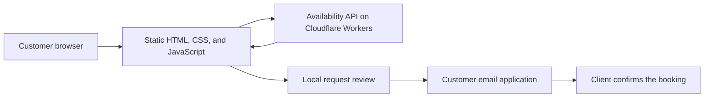

# At Home with Kat — Client Website Case Study

A responsive website and lightweight scheduling workflow created for an independent pet-sitting business.

**Live site:** [athomewithkat.signaturre.workers.dev](https://athomewithkat.signaturre.workers.dev/)

> This repository documents the project as a portfolio case study. Client-specific application source and business data are not included.

## Project Overview

The client previously managed pet-sitting availability with a physical planner. That process created friction when checking dates, responding to requests, and keeping the business organized away from the planner.

The goal was not to introduce a complicated booking platform. It was to create a focused system that would:

- make services and availability easy for customers to understand
- reduce repetitive scheduling conversations
- let customers prepare complete requests from one place
- preserve the client's control over pricing and booking confirmation
- remain simple enough for a small service business to use comfortably

## Solution

I designed and built a custom website using **HTML, CSS, and vanilla JavaScript**, deployed on Cloudflare's edge platform.

The site combines a public-facing service website with a lightweight request workflow:

1. Customers choose overnight sitting or drop-in visits.
2. A live calendar displays availability or scheduled activity.
3. Customers select dates and provide the essential pet-care details.
4. The site validates the request and checks the selected dates again.
5. Customers review the generated request before opening their email application or copying the message.
6. The client confirms availability, pricing, deposits, and policies personally.

This approach reduces administrative friction without turning a personal service into an impersonal automated booking system.

## Key Features

### Service-focused landing page

- clear descriptions for overnight sitting and drop-in visits
- direct calls to action without unnecessary navigation or account creation
- responsive presentation across desktop and mobile layouts

### Live availability calendar

- separate availability behavior for overnight stays and drop-in visits
- month navigation covering a rolling 12-month period
- visual states for available, booked, scheduled, unknown, and past dates
- range selection with checkout-date handling for overnight stays
- refresh behavior and graceful fallback when availability cannot be verified

### Guided request workflow

- service and date selection synchronized between the calendar and form
- client-side validation for required details and valid date ranges
- final availability check before preparing a request
- review step that clearly states a request is not a confirmed booking
- email-draft and copy-to-clipboard handoff instead of silently submitting data

### Accessibility and usability

- semantic sections, labels, buttons, and navigation
- skip link for keyboard users
- visible focus states
- descriptive alternative text
- ARIA live regions for calendar, validation, and delivery feedback
- reduced-motion support
- mobile-friendly controls and layouts

### Privacy and security decisions

- customers are warned not to enter door codes or other sensitive access details
- requests remain reviewable by the customer before leaving the browser
- nothing is sent automatically
- the client retains manual approval of dates and business terms
- deployed responses include a restrictive Content Security Policy and protective browser headers

## Architecture

The static frontend and availability service are separated so the public website can remain fast and simple while calendar data is refreshed independently.

See [Architecture and Design Decisions](docs/architecture.md) for more detail.

## Technology

- **HTML5** — semantic page and form structure
- **CSS3** — custom responsive layout and interaction states
- **JavaScript** — calendar rendering, availability checks, validation, and request preparation
- **Cloudflare Pages / Workers** — edge deployment and availability API

No frontend framework was required. The smaller vanilla stack keeps the experience fast, understandable, and proportionate to the client's needs.

## Design Decisions

### Request workflow instead of automatic booking

Pet-sitting requests often require context beyond whether a date appears open. Travel time, care requirements, pricing, and meet-and-greet details still need discussion. The site therefore helps customers prepare a complete request while leaving confirmation with the client.

### Calendar states instead of false certainty

The interface distinguishes confirmed conflicts from dates that still require confirmation. If the availability service is unavailable or stale, the site allows the customer to continue while clearly asking the client to verify the dates.

### Purpose-built interface instead of a large platform

The original problem was friction, not a lack of software features. A focused interface avoided accounts, dashboards, and administrative complexity that would have created a different kind of burden for the client.

## Outcome

The finished project replaced a planner-dependent customer experience with a centralized website where visitors can understand services, check dates, and prepare structured requests.

The client keeps the personal confirmation process that fits the business, while customers receive a clearer path from initial interest to a complete scheduling request.

## Skills Demonstrated

- translating a client's operational problem into a focused web solution
- responsive interface design and frontend development
- asynchronous API integration and defensive data validation
- date-range and service-specific interaction logic
- accessible form and calendar design
- privacy-conscious workflow design
- Cloudflare deployment and browser-security configuration
- balancing automation with a small business's real operating process

## Potential Enhancements

- administrative availability management interface
- optional confirmation emails through a transactional email service
- automated tests for calendar and date-range behavior
- analytics focused on request conversion without collecting unnecessary personal data
- custom production domain and expanded local-search metadata
